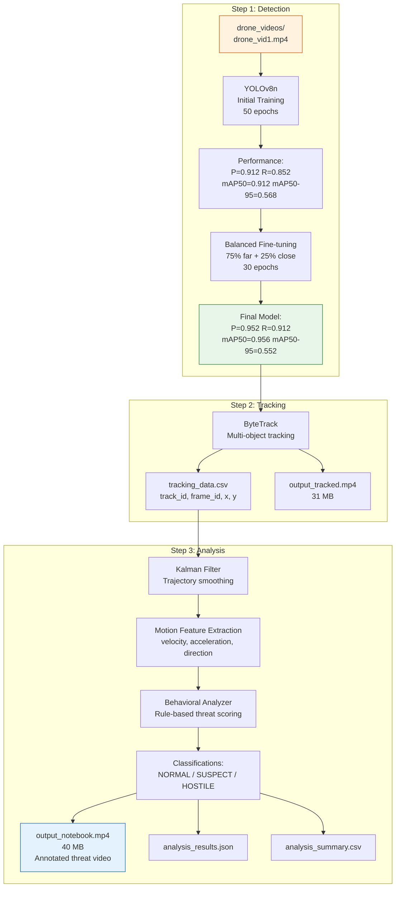

# Drone Detection & Trajectory Analysis Pipeline

> Complete YOLOv8 → ByteTrack → Behavioral Analysis pipeline for real-time drone threat detection  
> *Projet IA & TI — S7 — ENSA, Academic Year 2025–2026*

[](https://www.python.org/)
[](https://docs.ultralytics.com/)
[](https://github.com/ifzhang/ByteTrack)
[](LICENSE)

This project implements a complete pipeline for **drone detection, tracking, and behavioral threat assessment**. It starts from model selection and fine-tuning, proceeds through multi-object tracking with ByteTrack, and ends with trajectory analysis that classifies drone behavior as **Normal**, **Suspect**, or **Hostile** based on kinematic features.

---

## Table of Contents

- [Pipeline Overview](#pipeline-overview)
- [Detection Model Performance](#detection-model-performance)
- [Behavioral Analysis Results](#behavioral-analysis-results)
- [Architecture](#architecture)
- [Technology Stack]([Technology Stack](#technology-stack)
- [Dataset](#dataset)
- [Installation & Usage](#installation--usage)
- [Project Structure](#project-structure)
- [Limitations](#limitations)

---

## Pipeline Overview



---

## Detection Model Performance

### Training Evolution

| Stage | Model | Epochs | Dataset | Precision | Recall | mAP50 | mAP50-95 |
|-------|-------|--------|---------|-----------|--------|-------|----------|
| Initial | YOLOv8n | 50 | Close-up only | 0.912 | 0.852 | 0.912 | **0.568** |
| **Final** | **YOLOv8n (fine-tuned)** | **30** | **Balanced (75% far / 25% close)** | **0.952** | **0.912** | **0.956** | **0.544** |

### Key Observations

- **Fine-tuning improved precision** from 0.912 → 0.952 (+4.0 pp) and recall from 0.852 → 0.912 (+6.0 pp)
- The balanced dataset strategy (retaining all close-up images while sampling far-away ones) successfully prevented catastrophic forgetting
- Best validation epoch: **epoch 29** (mAP50-95 = 0.552)
- The drop in mAP50-95 from 0.568 to 0.544 after fine-tuning is expected — the model trades some strict IoU performance for better generalization across distances

### Confusion Matrix (Normalized, Final Model)

The normalized confusion matrix (`confusion_matrix_normalized.png`) shows strong diagonal dominance, confirming the model reliably distinguishes drone instances from background across both close and far ranges.

---

## Behavioral Analysis Results

Analysis was performed on `drone_vid1.mp4` across 7 tracked drones:

| Drone ID | Frames Analyzed | Avg Threat Score | Max Threat | Normal | Suspect | Hostile |
|----------|----------------|------------------|------------|--------|---------|---------|
| 1 | 388 | 33.1 | 80.0 | 291 (75.0%) | 20 (5.2%) | 77 (19.8%) |
| 2 | 10 | 7.0 | 35.0 | 8 (80.0%) | 2 (20.0%) | 0 (0.0%) |
| 5 | 6 | 21.7 | 60.0 | 3 (50.0%) | 2 (33.3%) | 1 (16.7%) |
| 13 | 5 | 7.0 | 35.0 | 4 (80.0%) | 1 (20.0%) | 0 (0.0%) |
| 16 | 7 | 0.0 | 0.0 | 7 (100%) | 0 (0.0%) | 0 (0.0%) |
| 21 | 13 | 25.4 | 60.0 | 10 (76.9%) | 2 (15.4%) | 1 (7.7%) |
| 22 | 1,242 | 26.4 | 80.0 | 1,183 (95.3%) | 22 (1.8%) | 37 (3.0%) |
| **Total** | **1,671** | — | — | **1,506 (90.1%)** | **49 (2.9%)** | **116 (6.9%)** |

### Threat Classification Rules

| Behavior | Threat Score Range | Criteria |
|----------|-------------------|----------|
| 🟢 **NORMAL** | 0–24 | Consistent speed and direction; no restricted zone violations |
| 🟠 **SUSPECT** | 25–59 | Sudden direction changes, moderate speed variations, or near restricted zones |
| 🔴 **HOSTILE** | 60–100 | High acceleration, erratic patterns, or restricted zone penetration |

---

## Architecture

### Step 1: Detection & Fine-tuning

- **Model:** YOLOv8n (nano — fastest inference, suitable for real-time)
- **Training:** 50 epochs on close-up dataset → fine-tuned 30 epochs on balanced dataset
- **Data augmentation:** RandAugment, mosaic (1.0), flip (50% horizontal)
- **Input resolution:** 640×640
- **Batch size:** 16
- **Optimizer:** Auto (SGD with momentum)

### Step 2: Multi-Object Tracking (ByteTrack)

- Associates detections across frames using ByteTrack's low-confidence match strategy
- Assigns persistent `track_id` to each drone
- Outputs: `tracking_data.csv` with columns `track_id, frame_id, x_center, y_center`
- Visual output: `output_tracked.mp4` (31 MB)

### Step 3: Trajectory Analysis & Behavioral Assessment

| Module | Technique | Purpose |
|--------|-----------|---------|
| **Kalman Filter** | Linear Gaussian predictor-corrector | Smooths noisy bounding box coordinates |
| **Motion Feature Extractor** | Finite differences on position data | Computes velocity, acceleration, direction changes per frame |
| **Trajectory Predictor** | Polynomial regression (degree 2) | Forecasts drone position 15–30 frames ahead |
| **Behavioral Analyzer** | Rule-based threshold system | Classifies each frame as Normal/Suspect/Hostile based on threat score |
| **Restricted Zone Monitor** | Point-in-polygon test | Detects when a drone enters user-defined polygon areas |
| **Visualizer** | OpenCV overlay | Draws trajectories, predicted paths, and threat alerts on video |

---

## Technology Stack

| Category | Technology |
|----------|-----------|
| **Language** | Python 3.10+ |
| **Detection** | Ultralytics YOLOv8 (PyTorch) |
| **Tracking** | ByteTrack |
| **Filtering** | Custom Kalman Filter (NumPy) |
| **Prediction** | Polynomial Regression (scikit-learn) |
| **Visualization** | OpenCV, Matplotlib |
| **Data** | Pandas, NumPy |

---

## Dataset

| Split | Far Images | Close Images | Total |
|-------|-----------|-------------|-------|
| **Train** | 2,004 | 951 | 2,955 |
| **Validation** | 842 | 203 | 1,045 |
| **Test** | 1,153 | 205 | 1,358 |
| **Total** | **3,999** | **1,359** | **5,358** |

**Far/close ratio:** 74.6% far / 25.4% close — designed to prevent catastrophic forgetting of close-up detection capability while adding long-range detection.

**Sources:**
- Close-up: Custom annotated dataset (`balanced_finetuning_dataset/`)
- Far-away: Anti-UAV (Anti-UAV300) dataset, frames extracted from video

---

## Installation & Usage

### Prerequisites

```bash
pip install ultralytics opencv-python lapx pandas scikit-learn matplotlib numpy
```

### Step 1 — Detection (already trained — models in `step1_detection/runs_finetune/`)

To retrain from scratch:

```bash
# Initial training on close-up dataset
yolo detect train \
  model=yolov8n.yaml \
  data=datasets/balanced_finetuning_dataset/dataset.yaml \
  epochs=50 batch=16 imgsz=640 \
  project=step1_detection/projet_yolov8 name=train_drone_colab

# Fine-tuning on balanced dataset
yolo detect train \
  model=step1_detection/runs/content/runs/detect/train_drone_colab/weights/best.pt \
  data=datasets/balanced_finetuning_dataset/dataset.yaml \
  epochs=30 batch=16 imgsz=640 \
  project=step1_detection name=finetune_drone_colab
```

### Step 2 — Tracking

Open `step2_tracking/bytetrack.ipynb`, update `MODEL_PATH` and `VIDEO_INPUT`, then run all cells.

Output: `tracking_data.csv` + `output_tracked.mp4`

### Step 3 — Analysis

Open `step3_trajectory_analysis/Trajectory_Analysis_Pipeline.ipynb`, run all cells.

Output: `output_notebook.mp4` (annotated video with threat alerts) + `analysis_results.json`

---

## Project Structure

```
drone_detection_project/
├── README.md                           # This file
│
├── datasets/
│   ├── balanced_finetuning_dataset/    # Final balanced dataset (5,358 images)
│   │   ├── dataset.yaml
│   │   └── images/
│   │       ├── train/   (2,955 images)
│   │       ├── val/     (1,045 images)
│   │       └── test/    (1,358 images)
│   └── drone_dataset_split/            # Original split (1,359 images)
│
├── drone_videos/
│   └── drone_vid1.mp4                  # Source video for tracking + analysis
│
├── step1_detection/
│   ├── projet_yolov8/
│   │   ├── train_yolov8_colab.ipynb    # Initial YOLOv8n training (50 epochs)
│   │   └── finetune_yolov8_colab.ipynb # Fine-tuning on balanced data (30 epochs)
│   ├── efficientdet/train_efficientdet.ipynb  # EfficientDet experiment (not selected)
│   ├── comparing_3_models/compare_models.ipynb # Model comparison notebook
│   ├── projet_yolov9/train_yolov9.ipynb       # YOLOv9 experiment (not selected)
│   ├── runs/content/                   # Initial training artifacts + weights
│   └── runs_finetune/content/         # Final fine-tuned artifacts + best.pt
│
├── step2_tracking/
│   ├── bytetrack.ipynb                 # ByteTrack multi-object tracking
│   ├── output_tracked.mp4              # 31 MB — video with tracked bounding boxes
│   └── tracking_data.csv               # Per-frame track positions
│
└── step3_trajectory_analysis/
    ├── Trajectory_Analysis_Pipeline.ipynb  # Full analysis pipeline
    ├── output_notebook.mp4               # 40 MB — annotated threat video
    └── results/
        ├── analysis_results.json          # Per-drone behavior breakdown
        ├── analysis_summary.csv           # Frame-level classifications
        ├── statistics.txt                 # Human-readable threat stats
        └── trajectory_plot.png            # Trajectory visualization
```

---

## Limitations

| Limitation | Impact | Proposed improvement |
|------------|--------|---------------------|
| Single video tested | Results may not generalize to other environments | Test on multiple videos with different lighting/weather |
| Small test set (1,358 images) | Performance estimates may be optimistic | Augment with more diverse drone datasets |
| Rule-based behavioral analysis | Thresholds are heuristic, not learned | Train a classifier (SVM/MLP) on labeled trajectory features |
| No real-time deployment | Pipeline runs offline on pre-recorded video | Deploy on edge device (Jetson Nano) with GStreamer pipeline |
| Kalman filter assumes linear motion | Cannot predict sudden maneuvering | Use Constant Turn Rate and Acceleration (CTRA) model |
| Restricted zones are static polygons | Cannot handle dynamic no-fly zones | Integrate with live geofencing APIs |
| No multi-sensor fusion | Relies solely on visual detection | Fuse with radar or RF signal detection |

---

## References

- **YOLOv8:** Ultralytics, https://docs.ultralytics.com/
- **ByteTrack:** Zhang et al., "ByteTrack: Multi-Object Tracking by Associating Every Detection Box", ECCV 2022
- **Anti-UAV Dataset:** Zhao et al., "Anti-UAV300: A Benchmark for UAV Detection and Tracking", https://github.com/ZhaoJ9014/Anti-UAV

---

*Developed as part of the S7 AI & Systems Engineering course at ENSA.*
